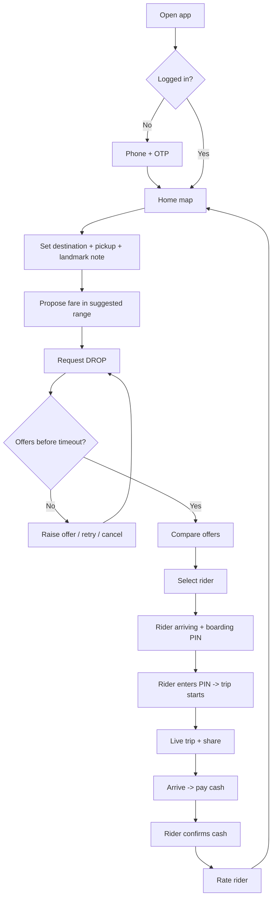
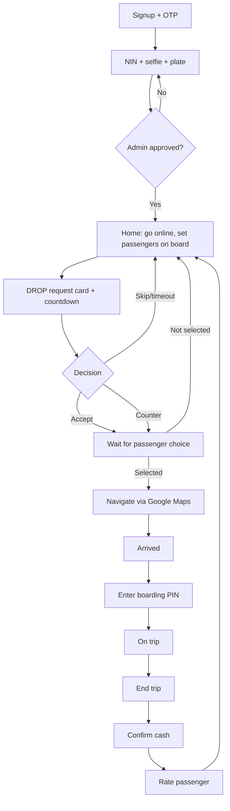

# DROP — User Flows & UI

**Status:** Draft v0.1 · **Date:** 2 Nov 2026 · **Inputs:** 01-PRD.md, 02-reference-analysis.md
**Stack:** React Native + Expo (TypeScript), Android-first with iOS too · Node/TS backend · Supabase Postgres + PostGIS · Google Maps
**Design:** Dark-first rich black theme with subtle gradients, Keke Yellow accent; Apple HIG feel (clean, generous spacing, SF-style type, large tap targets), adapted for low-end Android and low data.

## 1. Passenger flows

1. **Onboarding:** splash → phone number (+234 prefilled) → OTP (SMS, auto-read on Android) → name + optional photo → location permission (explain why first) → Home.
2. **Set trip:** Home map centres on GPS. Tap "Where to?" → destination search or pin. Pickup defaults to GPS; drag the pin to adjust → **landmark note** field ("Near Shoprite gate, blue kiosk"), with recent notes saved.
3. **Propose fare:** a fare sheet shows the **suggested range** (e.g. ₦A–₦B) with the midpoint prefilled. A stepper (± ₦50) and a numeric keypad can't go below the minimum. Primary button (yellow): **"Request DROP"**.
4. **Offers:** "Finding riders…" state with the countdown visible. Offer cards slide in: rider photo, name, rating, Keke plate/colour, ETA, offer amount (matches yours or a counter), "Carrying passengers" badge + dropping-off ETA if they're carrying passengers. Sort by ETA by default.
5. **Select:** tap a card → confirm → rider gets locked in, other offers are dismissed. The agreed fare is locked.
6. **Boarding PIN:** the trip screen shows the rider card + a big 4-digit PIN. The passenger checks plate/photo and tells the rider the PIN. The trip can't start until the rider enters it.
7. **Live trip:** map with rider location + "updated Xs ago", status (Arriving → Arrived → On trip), Call rider, Share trip, Report.
8. **Cash confirm:** at drop-off: "Pay ₦X cash" → the rider confirms receipt → passenger sees "Paid" (success green) (or taps "Didn't pay / dispute").
9. **Rate:** 1–5 stars + optional tags (Safe, Polite, Fast) → Done.
10. **Trip share:** an SMS/WhatsApp link with rider name, plate, live location and ETA, viewable on the web without the app.
11. **History:** list of past trips (date, route, fare, rider) → detail → Report issue.

## 2. Rider flows

1. **Signup + verification:** phone + OTP → name → **NIN** → live selfie → Keke **plate** + photo of the Keke → submit → "Pending review" (can be finished in person at a park) → Approved notification.
2. **Go online:** big Online/Offline toggle on Home. When online, a **"Carrying passengers?"** chip (0/1/2/3) lets the rider say how many people are already on board.
3. **Receive request:** a full-screen card with sound + vibration: pickup (+ landmark note), destination, distance to pickup, trip distance, passenger's offer, and countdown.
4. **Accept / counter:** **Accept ₦X** (primary), **Counter** (preset chips like +₦100/+₦200 or a custom amount; one counter allowed), or Skip. Then it waits for the passenger to choose; "Not selected" goes back to Home.
5. **Navigate:** when selected, the trip screen shows the passenger's first name, pickup note and **"Navigate"** → hands off to the Google Maps app (`google.navigation:` intent / URL) → "Arrived" button.
6. **Start with PIN:** enter the passenger's 4-digit PIN → trip starts (wrong PIN: 3 attempts, then contact support).
7. **Complete:** "End trip" at the destination → shows the agreed fare.
8. **Confirm cash:** "Received ₦X?" → Yes / Not paid (flags it to admin) → rate passenger.
9. **Earnings:** today's total + trips, week view, trip list. Commission/fees are displayed once the model is decided.

## 3. Edge cases

| Case | Behaviour |
|---|---|
| **No offers / timeout** | The request stays open about 60–90 s *(to be tuned)*. Then a "No riders yet" sheet: **Raise by ₦100/₦200**, Keep waiting, or Cancel. The suggested range stays visible. |
| **Offer expired** | Offer cards time out (about 30 s) and fade; the passenger can't select an expired one. |
| **Passenger cancels** | Free before a rider is selected. After selection, ask for a reason; repeated late cancellations get flagged. |
| **Rider cancels** | The passenger is told right away and the request goes back out with the same fare; the rider's cancellation rate is tracked. |
| **Rider no-show** | If the ETA passes a set buffer, or the rider hasn't moved for a while, the passenger gets "Rider delayed": wait, call, or cancel free + re-request. |
| **Passenger no-show** | The rider taps "Arrived". After a wait (e.g. 5 min) they can cancel with no penalty. |
| **Poor network** | Requests are retried quietly in the background. The last known location is shown with its age, and a banner appears when offline. The trip state is saved locally, and trip start/end are queued and synced later. Map tiles are cached; the rider app can show a text-only view (address + distance) without the map. |
| **Fare dispute** | The agreed fare is shown on both phones and logged. "Not paid" or a dispute goes to the admin queue. |
| **Restricted zone** | Destinations outside the service area or in restricted zones are blocked at request time with an explanation. |

## 4. Screen list

### Passenger app
| Screen | Purpose | Key elements |
|---|---|---|
| Welcome / Phone / OTP | Sign in | +234 field, OTP boxes, resend timer |
| Profile setup | Identity | Name, optional photo |
| Home | Start a trip | Map, "Where to?" bar, recent places |
| Set trip | Pickup + destination | Search, pin, landmark note |
| Fare sheet | Propose fare | Suggested range, stepper, minimum warning, Request DROP |
| Finding / Offers | Compare riders | Countdown, offer cards, Raise offer, Cancel |
| Trip | Arrival + ride | Rider card, PIN, map, status, Call/Share/Report |
| Payment + Rate | Finish | Amount due, paid status, stars, tags |
| History / Trip detail | Past trips | List, receipt, report |
| Settings / Safety | Account + trust | Trusted contact, help, logout |

### Rider app
| Screen | Purpose | Key elements |
|---|---|---|
| Phone / OTP | Sign in | Same as passenger |
| Verification steps | KYC | NIN, selfie camera, plate + Keke photo, progress bar |
| Pending review | Status | State, what's next, support contact |
| Home | Availability | Online toggle, passengers-on-board chip, today's earnings |
| Request card | Decide | Pickup/drop, distances, offer, Accept/Counter/Skip, timer |
| Waiting for choice | Feedback | Spinner, offer sent, cancel offer |
| Trip | Execute | Passenger name, note, Navigate, Arrived, PIN entry, End trip |
| Cash confirm + Rate | Close | Received Yes/No, stars |
| Earnings | Track income | Today/week totals, trip list |

*(The admin web dashboard is covered in the PRD and is out of scope for this doc.)*

## 5. Design system (compact)

**Colours (proposed): dark-first, black with gradients**

| Token | Hex | Use |
|---|---|---|
| `bg` | `#0A0A0B` | App background (deep black, not pure #000, so there's less smearing on cheap OLED screens) |
| `surface1` | `#141416` | Cards, list rows |
| `surface2` | `#1C1C1F` | Bottom sheets, offer cards |
| `surface3` | `#26262A` | Inputs, pressed rows, chips |
| `separator` | `#2E2E33` | Dividers, 1 px borders on cards |
| `gradTop` → `gradBottom` | `#1A1A1D` → `#0A0A0B` | Screen background gradient (vertical, subtle) |
| `gradSheet` | `#222226` → `#161618` | Sheet/card sheen (top-to-bottom) |
| `gradAccent` | `#FFD45C` → `#FFB800` | Optional: primary button / PIN highlight only |
| `primary` (Keke Yellow) | `#FFC629` | Main buttons, fares, PIN, active states, map pin |
| `primaryPressed` | `#E0AC1A` | Pressed state |
| `onPrimary` | `#0A0A0B` | Text/icons on yellow (always black, never white) |
| `textPrimary` | `#F5F5F7` | Primary text |
| `textSecondary` | `#A1A1A6` | Secondary text, labels |
| `textTertiary` | `#8A8A90` | Hints, timestamps (no smaller than 13 pt) |
| `disabled` | `#6E6E73` | Disabled controls only (not for readable text) |
| `success` | `#34C77B` | "Paid", "Trip complete", verified badge |
| `danger` | `#FF5A4F` | Cancel, SOS, errors |
| `warning` | `#FF9F0A` | Timeouts, rider delayed (icon + label, so it isn't confused with yellow) |

**Contrast (measured WCAG ratios):** yellow on bg is 12.6:1 and on surface3 9.6:1; black on yellow buttons is 12.6:1; textPrimary on bg is 18.2:1; textSecondary on surface2 is 6.6:1; textTertiary on surface1 is 5.4:1; success on bg is 9.0:1; danger on bg is 6.4:1. These all pass AA for body text. `disabled` (3.9:1) passes only for large or non-text elements.

**Sunlight readability:** use near-white text and solid yellow for all critical information (fare, PIN, plate, Accept). Keep gradients low-contrast and **only behind content**, never under text where they reduce legibility. Don't put essential information in mid-grey. The rider app uses textPrimary/yellow only, at a minimum of 17 pt, with an optional "High contrast" toggle that removes gradients.

**Low-end performance:** use one static gradient per screen (`expo-linear-gradient`) and no animated gradients or blur.

**Light-mode fallback (post-MVP / accessibility setting):** bg `#FFFFFF`, surface `#F4F5F7`, text `#111214` / `#5F6368`. Yellow is used only as a **button fill with black text**, never as text on white (that fails contrast); fares and PIN in light mode go in black on a yellow chip. The app is dark by default and doesn't follow the system setting at MVP.

**Type scale** (SF Pro on iOS, Inter/Roboto on Android; supports dynamic/font scaling)
| Style | Size/Line | Weight |
|---|---|---|
| Large Title | 34/41 | Bold |
| Title | 28/34 | Bold |
| Headline | 17/22 | Semibold |
| Body | 17/22 | Regular |
| Callout | 16/21 | Regular |
| Footnote | 13/18 | Regular |
| Fare / PIN display | 40/48 | Bold, tabular numbers |

**Spacing & shape:** 4-pt base grid: 4, 8, 12, 16, 24, 32, 48. Screen margins 16–20. Corner radii: 12 for cards, 16 for sheets, fully rounded for buttons/chips. Minimum tap target 48×48 dp (Android) / 44×44 pt (iOS); rider primary buttons 56 dp tall.

**Core components:** Primary/secondary/destructive buttons · bottom sheet (fare, offers) · Offer card · Rider card (photo, plate badge, rating) · PIN display + PIN input · Fare stepper · Countdown ring · Status pill · Landmark note field · Map pin · Toast/banner (offline, errors) · Star rating · Online toggle.

**Low-end Android / low data:** keep the APK small (Expo + Hermes, no heavy animations), fixed-size compressed images, map only where needed, throttled location updates (about 5 s on trip, slower while idle), skeleton loaders instead of spinners, no autoplay media.

**Accessibility:** WCAG AA contrast; never use colour alone (icon + text for status); screen-reader labels (TalkBack/VoiceOver) on every control; respect font scaling up to 200% without clipping; haptic + sound + visual alerts for rider requests; plain English copy, written so it can be localised (Pidgin/Yoruba later); sunlight-readable high contrast in the rider app.
