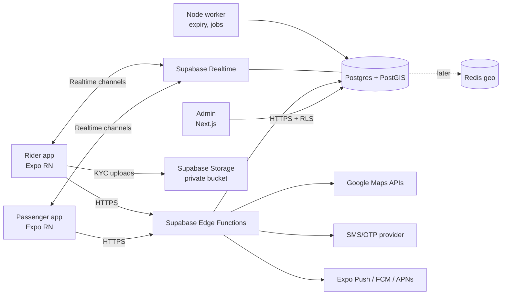
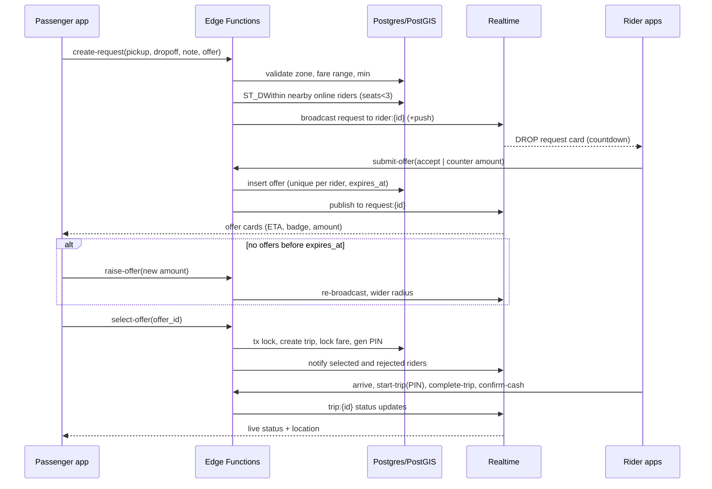

# DROP — Technical Architecture (MVP → scale)

**Status:** Draft v0.1 · **Date:** 2 Nov 2026 · **Aligned with:** 01-PRD, 02-reference-analysis, 03-user-flows-ui

## 1. Overview
- **Monorepo** (pnpm + Turborepo): `apps/passenger`, `apps/rider` (React Native + Expo, TypeScript, Android-first), `apps/admin` (Next.js), `packages/shared` (types, Zod schemas, fare rules, UI tokens), `packages/api-client`, `supabase/` (migrations, RLS policies, edge functions).
- **Supabase** is the core backend: Postgres + PostGIS, Auth (phone OTP), Realtime, Storage (rider KYC docs), Edge Functions (Deno/TS) for all state-changing trip logic.
- **Node/TS service** (added only when needed): long-running jobs (offer expiry sweeper, matching fan-out at scale, payment webhooks later).
- **Google Maps:** Maps SDK (via `react-native-maps`), Places Autocomplete (session tokens, debounced), Distance Matrix/Routes for fare suggestions. Turn-by-turn navigation is handed off to the Google Maps app.
- **Redis** (later): live rider locations + geo queries once Postgres write load from location updates becomes the bottleneck.

## 2. Data model (core)
All ids are `uuid`; timestamps are `timestamptz`; money is stored as `integer` kobo.

| Table | Key fields | Notes |
|---|---|---|
| `profiles` | `id` (= auth.users.id), `role` (passenger/rider/admin), `full_name`, `phone`, `photo_url`, `rating_avg`, `rating_count`, `status` (active/suspended), `created_at` | One row per user; a person can be both a passenger and a rider |
| `riders` | `profile_id` PK/FK, `verification_status` (pending/approved/rejected/suspended), `nin_last4`, `nin_verified_at`, `selfie_path`, `is_online`, `seats_occupied` (0–3), `last_location` geography(Point), `last_seen_at`, `approved_by`, `approved_at` | Full NIN isn't stored if a verification provider is used (only a reference + last 4) |
| `kekes` | `id`, `rider_id` FK, `plate_number` (unique), `colour`, `photo_path`, `active` | One active Keke per rider at MVP |
| `service_zones` | `id`, `name`, `area` geography(MultiPolygon), `type` (service/restricted), `active` | Lagos geofences; restricted zones still to be verified |
| `fare_rules` | `id`, `zone_id` FK, `base_kobo`, `per_km_kobo`, `min_kobo`, `range_low_pct`, `range_high_pct`, `effective_from` | Used to compute the suggested range + minimum |
| `ride_requests` | `id`, `passenger_id` FK, `pickup` geography(Point), `pickup_note`, `dropoff` geography(Point), `dropoff_label`, `distance_m`, `suggested_low_kobo`, `suggested_high_kobo`, `min_kobo`, `offer_kobo`, `status` (searching/matched/expired/cancelled), `radius_m`, `expires_at`, `created_at` | `offer_kobo` is updated when the passenger raises the offer (history kept in `request_events`) |
| `ride_offers` | `id`, `request_id` FK, `rider_id` FK, `type` (accept/counter), `amount_kobo`, `eta_s`, `seats_occupied_at_offer`, `status` (open/selected/rejected/expired/withdrawn), `expires_at` | Unique per (`request_id`, `rider_id`) → at most one counter per rider |
| `request_recipients` | `request_id`, `rider_id`, `round`, `sent_at` | Which riders were sent the request (used by RLS + analytics) |
| `trips` | `id`, `request_id` FK unique, `offer_id` FK, `passenger_id`, `rider_id`, `keke_id`, `agreed_fare_kobo` (locked), `pin_hash`, `pin_attempts`, `status` (assigned/arrived/in_progress/completed/cancelled), `cancelled_by`, `cancel_reason`, `assigned_at`, `arrived_at`, `started_at`, `completed_at` | Agreed fare can't be changed after it's written (trigger) |
| `payments` | `id`, `trip_id` FK, `method` (cash), `amount_kobo`, `status` (pending/confirmed/disputed), `confirmed_by_rider_at` | Card/transfer added later |
| `ratings` | `id`, `trip_id`, `from_id`, `to_id`, `stars` 1–5, `tags[]` | One per direction per trip |
| `reports` | `id`, `trip_id`, `reporter_id`, `category`, `details`, `status`, `assigned_admin` | Safety + disputes queue |
| `trip_shares` | `token` (random), `trip_id`, `expires_at` | Public read-only tracking link |
| `request_events` / `audit_log` | `entity`, `entity_id`, `actor_id`, `event`, `payload` jsonb, `at` | Debugging, disputes, admin actions |
| `devices` | `profile_id`, `push_token`, `platform` | Push notifications |

**Indexes:** GiST indexes on `riders.last_location` (partial `WHERE is_online AND verification_status='approved'`), on `service_zones.area` and on `ride_requests.pickup`; a btree index on (`status`, `expires_at`) for the expiry sweeps.

## 3. Realtime matching flow
1. **Create request** (`create-request`): check that pickup and dropoff are inside a service zone and not in a restricted one, then compute the suggested range and minimum from `fare_rules` and the road distance (Google Routes, cached by geohash pair). Reject `offer_kobo < min_kobo`.
2. **Find riders:** a PostGIS `ST_DWithin(last_location, pickup, radius)` query filters for online + approved + `last_seen_at` < 60 s + `seats_occupied < 3` + not on an active DROP trip, ordered by distance, top N (e.g. 15). Radius ladder: start at 1.5 km, widen to 3 km and then 5 km on later rounds if offers are few *(values to be tuned)*.
3. **Fan-out:** the request is published on each rider's private channel `rider:{id}` (Realtime broadcast) + a high-priority push for riders whose app is in the background.
4. **Rider responds** (`submit-offer`): accept (amount = passenger offer) or counter (amount > offer; one counter allowed, enforced by a unique constraint). The ETA is estimated server-side from distance and padded if `seats_occupied > 0` (the rider must drop off current passengers first); the offer card shows a "Carrying passengers" badge.
5. **Passenger sees offers** on `request:{id}`; each offer has `expires_at` (about 30 s). The request expires after about 60–90 s → the passenger can raise the offer (`raise-offer`: updates `offer_kobo`, re-runs fan-out with a wider radius) or cancel.
6. **Select** (`select-offer`): one transaction with a `SELECT … FOR UPDATE` row lock on the request: check that the offer is open and unexpired and the rider is still online and free → create the `trip` with a locked `agreed_fare_kobo` and a generated PIN → mark the other offers `rejected` → notify all riders who offered.
7. **Trip:** status changes go through edge functions (`arrive`, `start-trip` with PIN, `complete-trip`, `confirm-cash`). Locations stream on `trip:{id}`.
8. **Expiry:** a cron (pg_cron or the Node worker) runs every 10 s to mark expired offers and requests; clients also hide expired items locally using `expires_at`.

## 4. Key APIs / Edge Functions
| Function | Caller | Purpose |
|---|---|---|
| `fare-quote` | Passenger | Suggested range + minimum for pickup/dropoff |
| `create-request` / `raise-offer` / `cancel-request` | Passenger | Request lifecycle |
| `submit-offer` / `withdraw-offer` | Rider | Accept or counter |
| `select-offer` | Passenger | Atomic match → trip |
| `rider-status` | Rider | Online/offline, `seats_occupied` |
| `location-ping` | Rider | Throttled location update |
| `arrive` / `start-trip` / `complete-trip` / `cancel-trip` | Rider (cancel: both) | Trip state machine |
| `confirm-cash` / `dispute-payment` | Rider / Passenger | Payment closure |
| `rate-trip` / `create-report` | Both | Feedback, safety |
| `create-share-link` / `public-trip` | Passenger / public | Shared tracking (token, limited fields) |
| `kyc-submit` / `admin-review-rider` | Rider / Admin | Verification |
| `admin-*` (zones, fare rules, suspend) | Admin | Ops configuration |
Auth uses Supabase phone OTP (an SMS provider configured in Supabase). Reads such as history and profile go directly through PostgREST under RLS.

## 5. Location updates (low data)
- **Rider online & idle:** send location every 30 s or after moving about 100 m, whichever comes first; foreground service on Android (`expo-location` + task manager).
- **On an active trip / en route:** every 5 s or 20 m; stream on `trip:{id}` and keep only the latest value in the DB (`riders.last_location`) plus sampled breadcrumbs (e.g. every 30 s) for disputes.
- **Payload:** lat/lng rounded to 5 decimal places, heading, speed, accuracy, timestamp. Send in batches when the connection drops and keep the newest value first.
- **Passenger:** subscribes only while a trip is active, receives no location data otherwise, and shows "updated Xs ago". Map tiles are cached and there are no polylines from the server (a route summary only).
- **Places search:** debounce at 300 ms, minimum 3 characters, session tokens, recent places cached on the device.

## 6. Security
- **RLS on every table:** passengers read their own requests/trips; riders read their own offers/trips and only the requests sent to them (through `request_recipients`); the admin role is checked via a JWT claim. All state changes go through edge functions running as the service role; clients have **no direct write** access to `trips`, `ride_offers` or `payments`.
- **Rider verification:** NIN check (through a licensed verification provider *(to choose)*) + live selfie + plate + Keke photo, all approved by an admin before the rider can go online. KYC files go in a private Storage bucket and are viewed through short-lived signed URLs, admin-only. Riders are asked for a re-check selfie from time to time.
- **Boarding PIN:** 4 digits generated server-side and stored hashed; shown only to the passenger. `start-trip` checks it with a maximum of 3 attempts, then the trip is locked and flagged.
- **Fare lock:** `agreed_fare_kobo` is written once in `select-offer`; a DB trigger blocks updates. Disputes go to `reports`.
- **Rate limiting:** OTP sends per phone and per IP; `create-request` and `submit-offer` per user per minute; offers can't be submitted after `expires_at`. Device and phone limits help reduce fake accounts.
- **Privacy:** phone numbers are masked in the UI; calls go through a proxy/masking service later (direct calls at MVP *(decision)*). Share links expire when the trip ends.
- **Nigeria Data Protection Act (NDPA) 2023:** the plan includes a lawful basis and consent screens for location and KYC, a privacy notice, data minimisation (store a NIN reference rather than the full NIN where possible), retention limits for location history and KYC files, data-subject request handling, and assessing a DPO / NDPC registration and filing obligations. Where data is hosted (Supabase region) and any cross-border transfer requirement must be reviewed with Nigerian counsel. *This is not legal advice; requirements need to be checked with counsel.*

## 7. Scaling path (toward 10M users)
Staged; move to the next stage when monitoring shows it's needed, not ahead of time.
1. **MVP (Lagos pilot):** Supabase managed Postgres + Realtime + Edge Functions; pg_cron for expiry. Observability: Sentry (apps + functions), Supabase logs, simple metrics in the admin dashboard.
2. **Growth:** larger Postgres compute + read replicas for admin/history; move live rider locations to **Redis** (GEOADD/GEOSEARCH) with periodic flushes to Postgres; move matching and fan-out to the Node worker (queues, e.g. BullMQ); partition `request_events`/breadcrumbs by month.
3. **Multi-city / national:** shard matching by city (`zone_id`) across separate workers and Redis instances; geohash/H3 cell indexing; a dedicated realtime/WebSocket gateway if Supabase Realtime limits are reached; CDN for static assets; a data warehouse for analytics (CDC export).
4. **10M users:** self-managed Postgres or a larger provider tier if needed, event bus (e.g. Kafka/managed equivalent) between matching, trips, payments and notifications; multi-region failover. These targets need load tests before any capacity claim.

## 8. Key decisions (ADRs)
| # | Decision | Rationale | Revisit when |
|---|---|---|---|
| 1 | Supabase as the core backend | Auth OTP, Postgres/PostGIS, Realtime, Storage in one; small team | Realtime/DB limits or cost |
| 2 | All writes for state changes go through Edge Functions; RLS-only reads | Fare lock, PIN, race-free matching | — |
| 3 | PostGIS for matching at MVP, Redis later | Simpler; one source of truth | Location write load |
| 4 | Negotiated fare with server-enforced min/range, one counter per rider | PRD + reference analysis | Matching speed data |
| 5 | Google Maps app hand-off instead of in-app navigation | Less data/battery, less build effort | Rider feedback |
| 6 | Monorepo with shared types/fare logic | Consistency across apps + functions | — |
| 7 | Money in integer kobo | Avoid floating-point errors | — |
| 8 | Cash-only at MVP | PRD decision | Payments integration |
| 9 | Expo (managed + dev builds) | Speed; OTA updates; Android-first | Native module needs |
